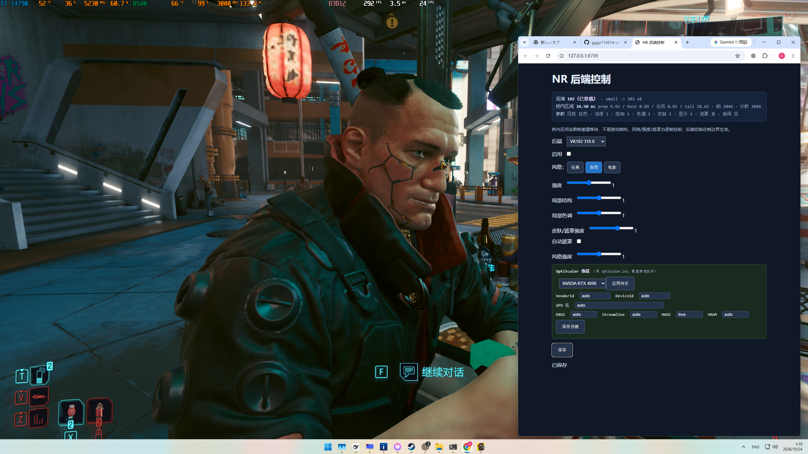
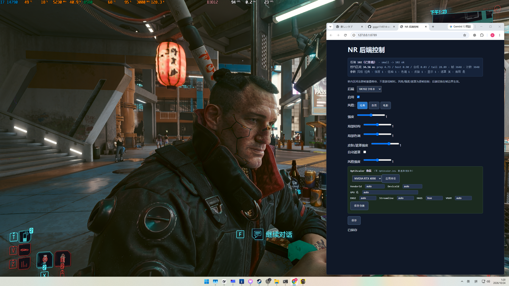
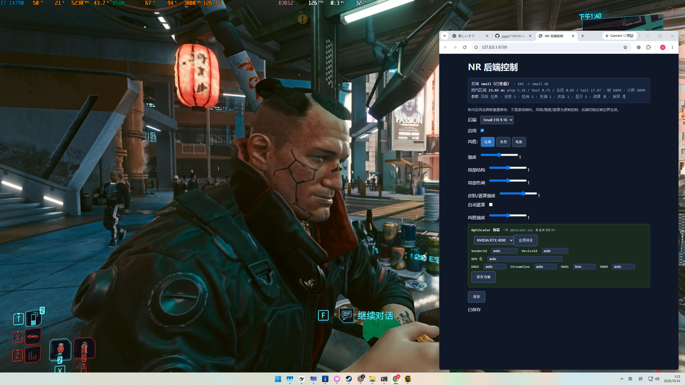
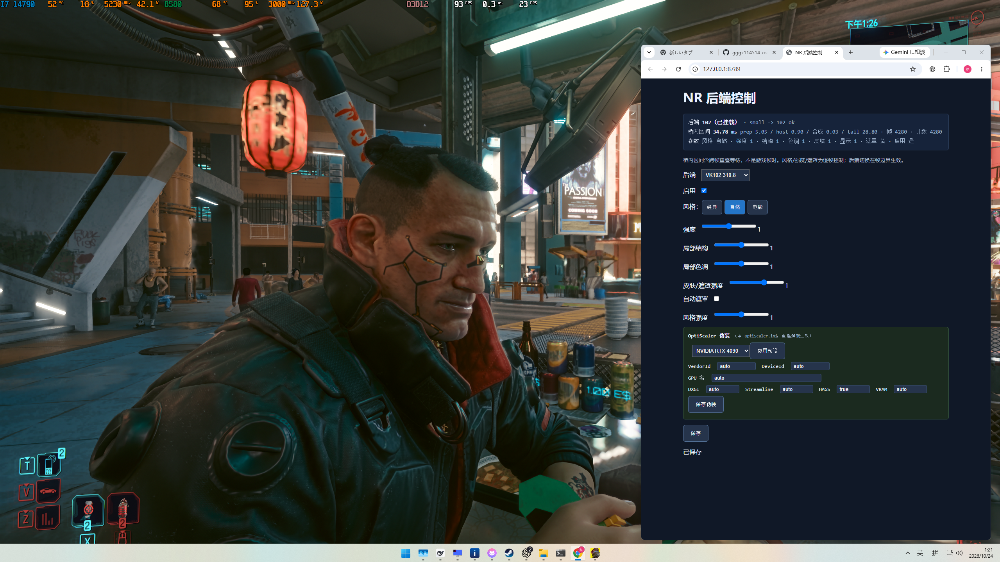
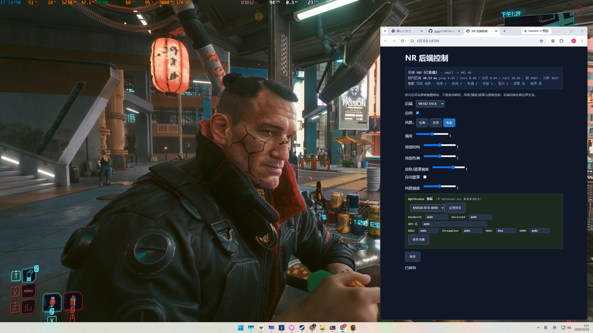
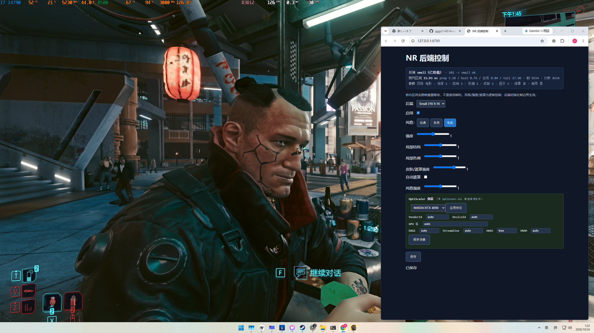

# Intel DLSS5 NR — Cyberpunk 2077

**2026-11-01 variable-resolution update:** Full and Small now follow the actual game render input, with native/720/540/480/360p NR controls and streaming enabled. Use `Install-Cyberpunk.cmd` after installing the build prerequisites: it fetches pinned model containers, builds both models, backs up game files and installs the panel. Existing SR/FG files are preserved; FSR XMX is installed separately. See the [installer guide](docs/ONE-CLICK-INSTALL.zh-CN.md) and [release validation](docs/MULTIRES-20261101.md). Native-control and device-recreation fixes are included.

**2026-10-29: Default builds now use optimized Full (232 dispatches, ~17.45 ms) and optimized Small (108 dispatches, ~9.98 ms), plus late-latch streaming (~5.43 ms game frame-period improvement in the recorded scene).** See [optimization history and evidence](docs/optimization/README.md). The Vulkan backend substantially references the community **mochizuki0323 / DLSSNR-AMD** project; see [attribution](docs/optimization/AMD-ATTRIBUTION.md). Build Full first, then pass `-FullModel local/vk102` when building Small.


[中文说明](README.zh-CN.md) · [Build dependencies and installation](INSTALL.md)

Experimental **NR + FSR XMX upscaling + XeSS Frame Generation** on Intel Arc B580 / Windows x64. This repository supplies the Vulkan **NR backend, game bridge, model extraction/build tools and control panel**. The FSR XMX upscaler and XeSS FG components are installed separately; XeSS FG here means frame generation, not XeSS Super Resolution.

**Detailed guides:** [Installation walkthrough (中文)](docs/USER-GUIDE.zh-CN.md) · [Full development history](docs/optimization/FULL-HISTORY.md) · [Technical retrospective](docs/optimization/TECHNICAL-RETROSPECTIVE.md) · [Other-game integration](PORTING.md)

**Download current main via Code → Download ZIP or git clone. The v0.2.0 release archive is historical; main contains the optimized profiles documented here.**

[实验工具与用法](tools/experiments/README.md) · [项目恢复与私人备份清单](docs/RECOVERY.md) · [研究源码档案](source/research-archive/README.md)

## What you need to supply

Provide the appropriate **local `nvngx_dlssnr.dll`**. Both backends can now be extracted and built from source; **an existing VK102 package is not required**. DLLs are read as data and never executed. No model DLL, weights, extracted tensors, compiled shaders or third-party game DLLs are distributed.

| Build profile | Model DLL | Resource | Frozen network | DLL SHA-256 |
|---|---|---|---|---|
| `small` | 310.9.16.0 Small | `WEIGHTS_CC_SMALL_FP8` | 76 rows / 108 dispatches | `2bc19bc09a7b89dd44f73e2ac0108fcc586e2154bdd0830f242f4f040e28789f` |
| `vk102` | 310.8.0.0 full model | `WEIGHTS_HT` | 152 rows / 232 dispatches | `8270b350cd82de5ce89806872cdd6b6a9249b80836b91bbeb3573470744cc206` |

Use separate folders for the two DLLs. Full also accepts the original `e16bcf15e16e13f527491cdf7845b2fe6521a738d8f7c9c721866a8496e1fc8e` container: all 599 tensors and 165 packed cold resources match the existing Full profile. Other DLL identities are rejected. A ZIP containing one supported DLL is accepted too. The profiles select the current optimized FP16 backends. INT8 remains a separate development branch.

## The tested combination and performance

| Component | Role | Supplied here |
|---|---|---|
| Vulkan NR (`small` or `vk102`) | Neural image processing and appearance controls | Source and local build tools |
| FSR XMX | Super resolution on the separately installed compatible XMX implementation | No third-party DLLs |
| XeSS FG / XeFG | Frame generation | No third-party DLLs |
| OptiScaler | Upscaler/frame-generation routing and the working game integration | External dependency |

## Current performance

Intel Arc B580, 1280×720 NR input:

| Measurement | Result |
|---|---|
| Full network, historical starting point → current head | **50.821 → 17.450 ms** |
| Latest Full campaign, paired batch | **18.724 → 17.450 ms (−1.273 ms)** |
| Optimized Small, paired fixed-input batch | **14.324 → 9.980 ms; 108 dispatches** |
| Cyberpunk streaming, same-scene game frame period | **34.81 → 29.38 ms (−5.43 ms)** |
| Corresponding base FPS, before frame generation | **28.74 → 34.04 FPS** |

[Complete optimization history](docs/optimization/FULL-HISTORY.md) · [Download and install](INSTALL.md) · [Integrate another game](PORTING.md)

Network rows measure NR inference. Streaming measures game frame period. The historical endpoints span development stages; paired results use the baseline recorded for that batch. NR input is fixed at 1280×720; super resolution produces the display image. Frame-generation presentation FPS and panel bridge intervals have their own measurement scopes.

## Build either model from its DLL

Required: Windows x64 / B580, Python 3.12+ with NumPy, Visual Studio 2022 C++ Build Tools and Windows SDK, CMake 3.24+, **glslang 16.5.0**, Vulkan headers, and the pinned OptiScaler source dependency described in [INSTALL.md](INSTALL.md). These are development dependencies; an NR package is not one of them. Use a short, writable ASCII path such as `C:\Dev\intel-dlss5nr-cyberpunk2077`; existing native file APIs still have Windows path-length limits.

From the repository root:

```powershell
python -m venv .venv
.\.venv\Scripts\python.exe -m pip install -r requirements-model.txt

# Paths to your separately installed development dependencies.
$py = ".\.venv\Scripts\python.exe"
$opti = "C:\Dev\OptiScaler"
$glslang = "C:\Tools\glslang\bin\glslang.exe"
$vk = "C:\VulkanSDK\Include"

# VK102: local/vk102 -> local/game-package-vk102
.\tools\Build.ps1 -Profile vk102 -Dll "C:\Models\VK102\nvngx_dlssnr.dll" `
  -OptiScalerSource $opti -Glslang $glslang -VulkanInclude $vk -Python $py

# Small: local/small -> local/game-package
.\tools\Build.ps1 -Profile small -FullModel "local/vk102" -Dll "C:\Models\Small\nvngx_dlssnr.dll" `
  -OptiScalerSource $opti -Glslang $glslang -VulkanInclude $vk -Python $py
```

Build Full first; build Small afterward for the Small backend or model switching. The entry point verifies the DLL and extracted tensors, packs the exact B580 weight layout, compiles the frozen network and bridge shaders, builds the native component and ASI, runs CPU checks and assembles a local game package. **It does not install or start the game.** Use new/empty model and package output directories; `-Output` and `-PackageOutput` can select different locations for another build.

Each package contains its own `manifest/`, generated `assets/`, matching `bin/nrvk_bridge.dll`, `game-files/`, `panel/` and `config/`. Keep it together at its final location. The new VK102 path verifies **599 tensor files, 165 cold resources and 39 network shaders**; developer fixture images are not used.

## Configure and install

Close the game and keep its existing working OptiScaler + FSR XMX + XeSS FG installation. Back up the existing game `bin/x64` files and settings before copying anything.

For **Small only**:

```powershell
python local/game-package/panel/configure_game.py --package local/game-package --game-bin "C:/Games/Cyberpunk2077/bin/x64"
```

For **VK102 only**, built from your full-model DLL above:

```powershell
python local/game-package-vk102/panel/configure_game.py --package local/game-package-vk102 --game-bin "C:/Games/Cyberpunk2077/bin/x64"
```

For **both**, boot Small and register the newly built VK102 package:

```powershell
python local/game-package/panel/configure_game.py --package local/game-package --game-bin "C:/Games/Cyberpunk2077/bin/x64" --vk102-manifest local/game-package-vk102/manifest
```

Copy the **contents** of the chosen boot package's `game-files/` into the game's `bin/x64/`. Do not install both sets over one another. A VK102 boot package can instead register Small with `--small-manifest local/game-package/manifest`.

The configuration command updates paths inside the package only. It requires your game EXE and OptiScaler INI to exist, preserves NR appearance settings, and does not edit the game or install upscaler/FG DLLs. If you move a package, rerun configuration and recopy its generated `plugins/nr_bridge.ini`.

## Use the panel

Run `Launch-NR-Panel-Game.cmd` from the chosen boot package to open the control panel, then launch Cyberpunk from your normal game launcher. This script starts the panel only. It uses Windows Python Launcher (`py -3`); alternatively run `python panel/nr_control_panel.py` from the package directory. Default address: **http://127.0.0.1:8788/**. To use another port, set `NR_PANEL_PORT` before launching. Local screenshots use port 8789 because another panel was already running.

- **Backend**: `VK102 310.8` / key `102` selects optimized Full; `Small 310.9.16` selects optimized Small. Only configured backends are shown. Select Small or VK102 and Save. The bridge switches at a frame boundary, resets history and uses that model's own component and assets.
- **Enabled / style / strength / structure / tone / skin / mask / display strength**: per-frame appearance controls; they do not rebuild a model. Styles are Classic, Natural and Cinematic.
- **Mounted + increasing processed count**: check actual processing, not just DLL loading. Inspect scene cuts, loading/reset, motion and exposure changes yourself.
- **OptiScaler spoof presets**: game restart required. Edit only with the game closed; the panel retains an INI backup. No elevation or alternate-shell bypass is used.

In the local working combination, OptiScaler used `Dx12Upscaler=fsr31` for its FSR4/XMX-capable route, `FGInput=DLSSG` and `FGOutput=XeFG`. The route name alone does not prove that an arbitrary FSR DLL is XMX accelerated. Supply compatible components separately, following their own installation instructions. This repository does not silently replace them or the global driver environment.

## Real game screenshots

Original user-supplied screenshots, preserved without retouching. “Original” below means **NR disabled**, not proof that upscaling and frame generation are disabled. The panel states identify the selected model/style. Camera, NPC pose and lighting vary, so these are appearance examples rather than pixel-aligned A/B measurements.

### NR disabled / original image



### VK102 and Small styles

| Style | VK102 310.8 | Small 310.9.16 |
|---|---|---|
| Classic |  |  |
| Natural |  |  |
| Cinematic |  |  |

Click an image for its original resolution. Screenshots are documentation assets explicitly supplied for publication; model/input/output fixture dumps are excluded.

## Rollback and limitations

Close the game. Restore your backed-up `nrvk_bridge.dll`, `plugins/CyberpunkNRBridge.asi`, `plugins/nr_hdr_proxy.hlsl`, `plugins/nr_bridge.ini` and `plugins/NRB-deferred-identity.enable`; remove only files introduced by this installation. Restore the intended OptiScaler INI backup if you changed spoof settings. Leave unrelated game files alone.

This Experimental source release targets Windows x64, Intel Arc B580 and 1280×720 NR input. Keep generated `local/` and `build/` assets on your own machine; the repository distributes source and build recipes.

[BUILD-VERIFICATION.md](BUILD-VERIFICATION.md) records build checks. GLSL builds verify raw compiler output before restoring the frozen `NoContraction` decorations, then verify final SPIR-V hashes. No precompiled shader payload is embedded in scripts.

Reference/model tools: [DLSSNR-AMD](https://github.com/mochizuki0323/DLSSNR-AMD). See [LICENSES.md](LICENSES.md) and [PORTING.md](PORTING.md). This is not an official NVIDIA, Intel, AMD, CD Projekt Red or OptiScaler product.
